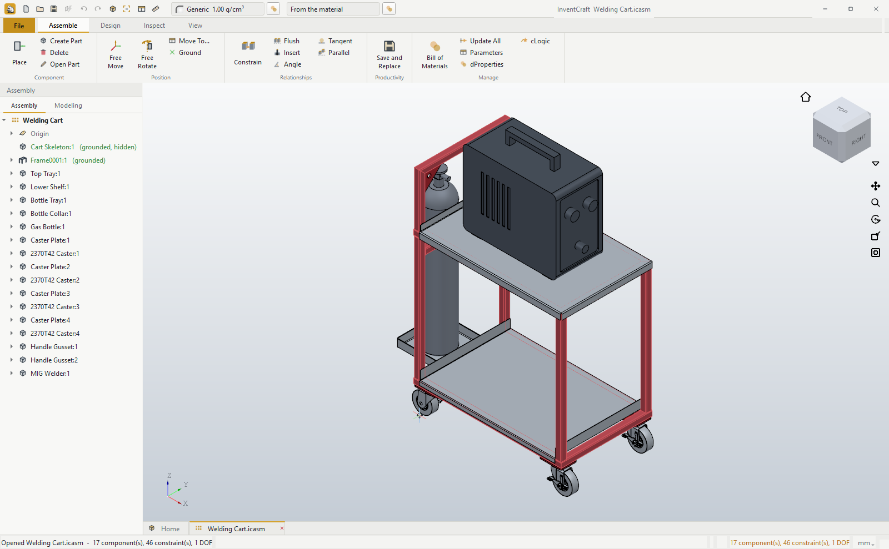

# Welding Cart

A cart for a MIG welder and its gas bottle: the sample that shows the whole
of InventCraft in one machine, the kind of thing the workshop it was
written in actually builds.

    ../build_cart.py          builds everything in this folder
    ../../tests/shot_cart.py  opens it and takes the website's pictures
    ../../tests/test_cart.py  checks it still goes together

Nothing here was drawn by hand or nudged into place. The script goes through
the same core API the buttons call, so every file opens, edits and rebuilds
normally.

## What it shows

| | |
|---|---|
| **Frame Generator** | `Cart Skeleton` is a part of sketch lines: the two frames, the legs, the handle and the rail the bottle's collar bolts to. `Welding Cart/Frame0001` is the frame on it, 16 members of DIN EN 10219-2 30 x 30 x 2 tube, ten corners mitred. Each member is a part of its own: a profile sketch extruded to its length. Change the skeleton and the frame follows. |
| **Sheet metal** | `Top Tray` (lips down, a fence up at the back, relieved where they meet), `Lower Shelf`, `Bottle Tray` and `Bottle Collar`, each with its flat pattern. |
| **CAM** | `Cart Plates` nests the four caster plates and two handle gussets on a sheet of 6 mm for the plasma table. |
| **Parts** | `MIG Welder` and `Gas Bottle`, modelled from sketches: extrusions, cuts and a revolve. |
| **Assembly** | `Welding Cart` holds it all with 46 Mate, Flush, Insert and Parallel constraints. Only the skeleton is grounded (the frame follows it); the one degree of freedom left is the bottle turning where it stands. |

## The casters

The cart is drawn for McMaster-Carr's 2370T42, a 4" swivel caster with a
brake, and the caster plates are drilled to its mounting. The caster in this
folder is modelled here at its size and mounting, because McMaster's own
STEP file may be used but not passed on.

To build the cart with the real one, download its STEP file from
McMaster-Carr, put it at `vendor/2370T42 Cart-King Caster.step` (that folder
is never committed) and run

    python examples/build_cart.py --vendor

That is how the pictures on the website are made, into a folder of their
own so this one is left as it is:

    DATUM_CART_OUT=<somewhere> python examples/build_cart.py --vendor
    DATUM_CART_OUT=<somewhere> python tests/shot_cart.py
